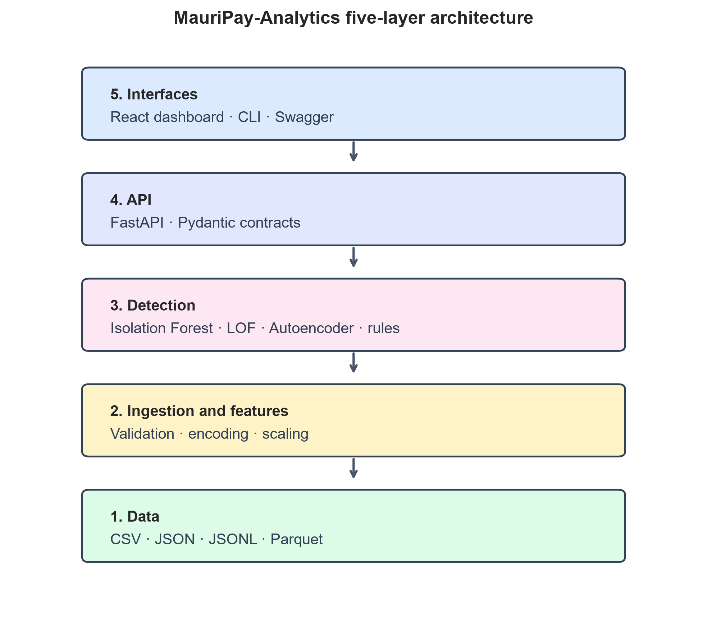
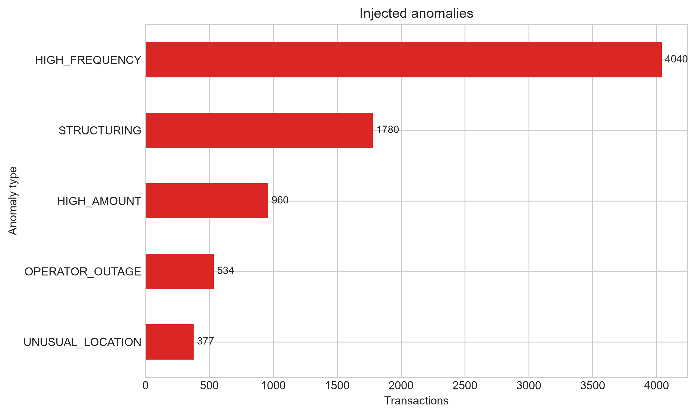
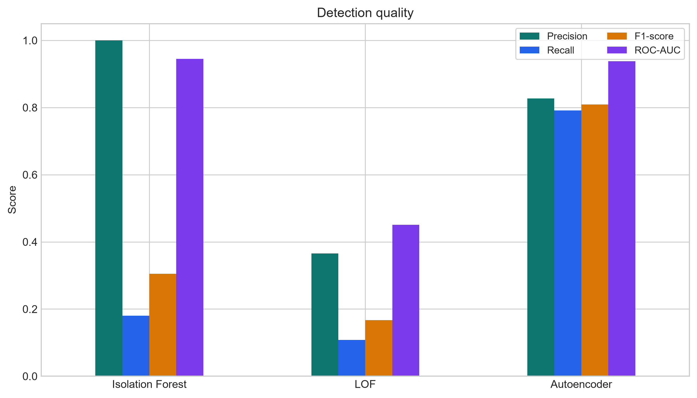
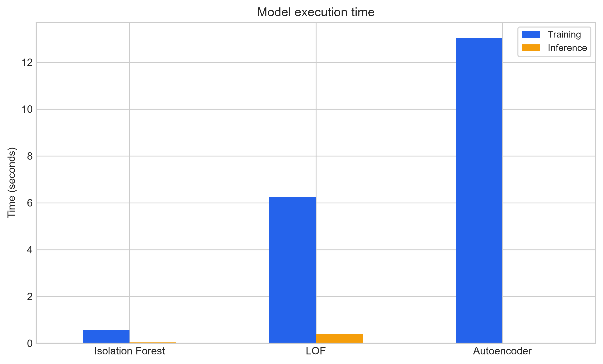
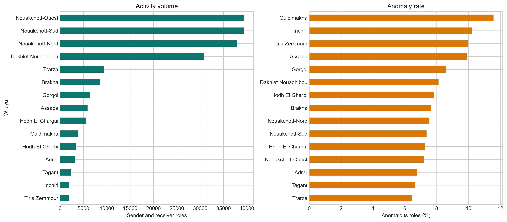

# MauriPay-Analytics: Open-Source Mobile Money Analytics and Anomaly Detection

**Seydna Aly Eby**^a^, **Eby Cheikhna Sidiboubacar**^a^, **Mohamedou Cheikh Tourad**^a,b^

^a^ Institut Supérieur de Comptabilité et d’Administration des Entreprises, Nouakchott, Mauritania  
^b^ Université de Nouakchott — Faculté des Sciences et Techniques, Nouakchott, Mauritania

**Corresponding author:** Mohamedou Cheikh Tourad, cheikhtouradmohamedou@gmail.com

> Manuscrit SoftwareX — version de travail S15.

## Abstract

Mobile money services have expanded access to digital payments across Africa,
but research and development on transaction anomaly detection remain limited
by the scarcity of public, context-sensitive datasets and reusable open-source
tools. MauriPay-Analytics addresses this gap through an open-source platform
for generating, validating, analysing, and visualising mobile money
transactions, with particular attention to Mauritanian and West African usage
patterns. The software follows a five-layer architecture covering data,
ingestion and feature engineering, anomaly detection, a FastAPI application
programming interface, and user interfaces including a React dashboard. Its
synthetic generator, MauriPay-M, models transaction channels, wilayas,
operators, Ramadan activity, bill payments, diaspora transfers, and tontines,
and injects five configurable anomaly families. The detection pipeline combines
Isolation Forest, Local Outlier Factor, and a neural autoencoder with
interpretable business rules. Reproducible Jupyter notebooks demonstrate
dataset generation, model benchmarking, and geographic analysis. By integrating
data generation, machine-learning experiments, analytical endpoints, and
interactive visualisation in a single extensible package, MauriPay-Analytics
supports teaching, reproducible research, prototyping by payment operators, and
exploratory analysis by regulators in Mauritania and the wider West African
region.

## 1. Motivation and significance

Mobile money has become an important channel for person-to-person transfers,
cash deposits and withdrawals, airtime purchases, merchant payments, and bill
payments across Africa. This growth increases the operational value of timely
transaction monitoring: unusual amounts, repeated operations, transaction
splitting, service outages, and unexpected geographic behaviour may indicate
fraud, misuse, or technical incidents [@gsma2025mobilemoney;
@worldbank2022findex]. However, access to real transaction data
is restricted by privacy, security, commercial confidentiality, and regulatory
requirements. These constraints make it difficult for students and researchers
to reproduce experiments or compare detection methods on a common dataset.

Existing proprietary monitoring platforms may also be inaccessible to research
teams and small organisations because their source code, internal scoring
methods, and datasets are not generally available for inspection. Open datasets
that preserve realistic operational and regional characteristics remain
limited. Consequently, a reproducible platform is needed to connect synthetic
data generation, schema validation, feature engineering, anomaly detection,
evaluation, and visual analytics without requiring access to personal financial
records.

Mauritanian mobile money activity has contextual characteristics that are not
fully represented by generic financial datasets. MauriPay-Analytics therefore
models USSD, mobile application, and agent channels; sender and receiver
wilayas; local operators; MRU and supported regional or international
currencies; bill payments; diaspora cash-in operations; tontine-like activity;
and changes in transaction timing during Ramadan. These variables are useful
both for generating plausible normal behaviour and for interpreting anomalous
events. The resulting data are entirely synthetic and are intended for
education, software testing, and methodological research rather than for
reproducing the behaviour of identifiable customers.

PaySim is an influential mobile money simulator that demonstrated how a
simulation can support fraud-detection research when real financial records are
unavailable. MauriPay-Analytics follows the same broad motivation while serving
a different purpose and context. PaySim primarily provides a simulation model
and associated fraud scenarios; MauriPay-Analytics provides an end-to-end
analytics platform comprising generation, multi-format ingestion, validation,
feature engineering, three anomaly detectors, business rules, a REST API,
reproducible notebooks, and a dashboard. It also adds Mauritanian geographic
and business concepts, including wilaya-level analysis. This positioning is
complementary: PaySim remains an important reference simulator
[@lopezrojas2016paysim], whereas MauriPay-Analytics focuses on an extensible
regional software workflow aligned with Mauritania's financial-inclusion and
digital-payment objectives [@bcm2023snif; @bcmDigitalPayments].

## 2. Software description

### 2.1 Software architecture

MauriPay-Analytics separates responsibilities into five layers. The data layer
stores generated datasets, uploaded files, trained artefacts, and prediction
outputs. The ingestion and feature-engineering layer validates transactions and
converts their raw attributes into numerical model inputs. The detection layer
contains the machine-learning detectors, evaluation utilities, ensemble logic,
and business rules. The API layer exposes these functions through FastAPI. The
interface layer comprises a command-line interface, Swagger UI, and a React
dashboard. This separation allows each component to be used independently or
as part of the complete `generate → ingest → detect → visualize` workflow.

The corresponding source modules are `mauripay/synthetic/`,
`mauripay/ingestion/`, `mauripay/features/`, `mauripay/detection/`, and
`mauripay/api/` under `backend/src/`. The `frontend/` directory contains the
dashboard, `notebooks/` contains the reproducible experiments, and `docs/`
contains the Sphinx and MyST technical documentation.

*Figure 1. The five software layers and their principal technologies.*

### 2.2 Data model

The canonical transaction schema is implemented as a Pydantic v2 model. Each
record contains a transaction identifier and UTC timestamp; anonymised sender
and receiver identifiers; amount, currency, and fees; transaction type,
channel, operator, and status; sender and receiver wilayas; a Ramadan flag;
optional bill-provider and origin-country fields; and the synthetic ground-truth
fields `is_anomaly` and `anomaly_type`. Supported operations include transfers,
cash-in, cash-out, bill payments, airtime purchases, and merchant payments.

Validation requires positive amounts, non-negative fees, distinct sender and
receiver accounts, timezone-aware UTC timestamps, and consistent conditional
fields. For example, a bill provider is required only for a bill payment, while
an origin country is permitted for diaspora-related cash-in operations. The
anomaly flag and anomaly type must also agree. Validated transactions can be
loaded from CSV, JSON, JSONL, or Parquet files.

### 2.3 Synthetic transaction generator

MauriPay-M generates configurable synthetic transaction datasets without using
real customer records. A fixed pseudo-random seed makes an experiment
repeatable; the illustrative notebooks use `seed=42`. The generator produces
non-uniform channel, operator, transaction-type, amount, temporal, and
geographic distributions. It includes contextual normal patterns such as
Ramadan activity, salary periods, bill payments, diaspora transfers, and
tontines.

Five labelled anomaly families can be injected: unusually high amounts, high
transaction frequency, structuring through multiple smaller operations,
operator-outage sequences, and unusual locations. Sequence-based injections
may generate several anomalous rows; therefore, the final fraction of labelled
rows can exceed the parameter controlling isolated anomalies. Dataset size and
the rates of simple anomalies, tontines, structuring, and high-frequency events
are configurable.

### 2.4 Feature engineering

The feature pipeline converts validated transactions into model-ready matrices.
Temporal features represent the hour, night-time activity, gaps between
transactions, and rolling counts. Financial features include the amount, its
logarithmic transformation, recent means, and sender-relative deviations.
Geographic features represent cross-wilaya activity, approximate distance, and
new sender-location relationships. Behavioural variables describe beneficiary
novelty or rarity and incoming and outgoing activity. Interpretable risk
signals capture cases such as failure with zero fees, transaction structuring,
and high-frequency sequences.

Categorical values are one-hot encoded, while numerical features are scaled
using fitted preprocessing objects. The same fitted transformations are reused
during prediction to preserve feature order and scale. Identifiers and the
synthetic labels, particularly `is_anomaly` and `anomaly_type`, are excluded
from model inputs to prevent target leakage.

### 2.5 Anomaly detection

The detection layer implements three complementary unsupervised approaches.
Isolation Forest isolates rare observations through random partitions; short
isolation paths indicate greater suspicion [@liu2008isolation]. Local Outlier Factor compares the
local density of a transaction with the densities of neighbouring observations [@breunig2000lof].
The neural autoencoder learns to reconstruct normal feature vectors, and a high
reconstruction error indicates behaviour that differs from its training
distribution [@hinton2006dimensionality].

Each detector returns an anomaly score, a decision threshold, and a binary
label. Raw scores are model-specific and should not be compared directly across
algorithms. The software also provides an ensemble decision and interpretable
business-rule signals for high amounts, failures without fees, high frequency,
structuring, operator outages, and unusual locations. These outputs identify
transactions requiring investigation; they do not constitute proof of fraud.

### 2.6 API and dashboard

FastAPI exposes ingestion and generation through `/ingest` and
`/ingest/generate`. The detection routes list available models and support
training, individual prediction, and joint prediction through `/detect/models`,
`/detect/train`, `/detect/predict`, and `/detect/predict-all`. Analytical routes
provide aggregate statistics, temporal series, and wilaya-level results through
`/stats`, `/timeseries`, and `/geo`. Pydantic request and response models define
the exchange contracts, while OpenAPI and Swagger provide interactive API
documentation.

The React dashboard guides a user from dataset selection and analysis execution
to the inspection of consensus results and suspicious transactions. Dedicated
views present summary indicators, operation distributions, temporal behaviour,
geographic activity, temporal anomalies, and geographic anomalies. The
dashboard calls the API rather than reimplementing the analytical pipeline,
which keeps programmatic and visual results consistent.

## 3. Illustrative examples

### 3.1 Dataset generation and exploration

The first notebook generated a MauriPay-M dataset of 100,000 transactions with
the fixed seed 42. The timestamps cover 1 January to 31 March 2026. The dataset
contains 18 fields and a total simulated value of MRU 3.154 billion. The mean
transaction amount was MRU 31,544.79, while the median was MRU 18,003.76. The
marked difference between the mean and median, together with a maximum of MRU
2.642 million, illustrates the right-skewed amount distribution and motivates
the logarithmic amount transformation used in feature engineering.

USSD accounted for 71,704 transactions (71.70%), mobile applications for
23,082 (23.08%), and agents for 5,214 (5.21%). The generator therefore produces
unequal channel frequencies rather than sampling every channel uniformly.
Activity is also geographically concentrated: after counting sender and
receiver roles, Nouakchott-Ouest, Nouakchott-Sud, Nouakchott-Nord, and Dakhlet
Nouadhibou recorded the largest volumes. These counts describe transaction
roles and consequently sum to twice the number of transactions.

The dataset includes 55,343 Ramadan transactions and 44,657 transactions
outside Ramadan. The normalised hourly profiles allow differences in the timing
of activity to be compared without confusing them with the unequal group
sizes. MauriPay-M labelled 7,691 rows as anomalous, corresponding to 7.69% of
the dataset: 4,040 high-frequency rows, 1,780 structuring rows, 960 high-amount
rows, 534 operator-outage rows, and 377 unusual-location rows. This final rate
is higher than the 2% isolated-anomaly parameter because the structuring and
high-frequency generators create multi-transaction sequences.

The corresponding channel, amount, Ramadan, and anomaly-distribution figures
are generated by `01_generation_et_exploration.ipynb` and are intended for
inclusion as publication figures after final visual validation. Figure 2
summarises the five injected anomaly families.

*Figure 2. Number of anomalous transaction rows generated for each injected
pattern.*

### 3.2 Detection benchmark

The second notebook compared Isolation Forest [@liu2008isolation], Local
Outlier Factor [@breunig2000lof], and an autoencoder
[@hinton2006dimensionality]. The 10,000 transactions were sorted by timestamp;
the first 8,000 formed the training set and the final 2,000 formed an independent
temporal evaluation set containing 139 labelled anomalies. Preprocessors were
fitted only on training data. The autoencoder preprocessor and detector were
trained on the normal training subset. Table 1 reports the reference execution
on CPU.

**Table 1. Detection results on the temporal evaluation set.**

| Model | Precision | Recall | F1-score | ROC-AUC | Training (s) | Inference (s) | Alerts |
|---|---:|---:|---:|---:|---:|---:|---:|
| Isolation Forest | 1.0000 | 0.1799 | 0.3049 | 0.9448 | 0.5597 | 0.0387 | 25 |
| LOF | 0.3659 | 0.1079 | 0.1667 | 0.4512 | 6.2258 | 0.4077 | 41 |
| Autoencoder | 0.8271 | 0.7914 | 0.8088 | 0.9382 | 13.0461 | 0.0140 | 133 |

*Figure 3. Precision, recall, F1-score, and ROC-AUC on the temporal evaluation
set.*

*Figure 4. Training and inference times on the reference CPU environment.*

Precision measures the proportion of alerts that correspond to injected
anomalies, whereas recall measures the proportion of injected anomalies that
were detected. The F1-score balances these two quantities. Training and
inference times characterise computational cost, but remain dependent on the
hardware and runtime environment.

Isolation Forest produced no false positives in this run but detected only 25
of the 139 anomalies, giving high precision and low recall. LOF generated more
false alerts while recovering fewer true anomalies, resulting in the lowest
F1-score. The autoencoder recovered 110 anomalies with 23 false positives and
therefore achieved the strongest precision--recall balance, at the cost of the
longest training time. These observations do not establish universal model
superiority: they apply to this synthetic dataset, temporal split,
preprocessing pipeline, and hyperparameter configuration. Repeated runs across
seeds and datasets are required to estimate variability and generalisation.

The full protocol, hardware, and library versions are recorded in
[experimental_environment.md](experimental_environment.md); the machine-readable
results are in [tables/model_results.csv](tables/model_results.csv).

### 3.3 Geographic analysis

The third notebook reproduced the aggregation logic of the `/geo` API locally.
Sender and receiver records were converted into geographic activity events and
grouped by wilaya. For each wilaya, the analysis reports the number of roles,
their combined transaction amount, number of anomalous roles, failure rate,
and anomaly rate. Nouakchott-Ouest had the largest activity volume, with 39,461
roles, MRU 1.272 billion, and 2,851 anomalous roles. Nouakchott-Sud recorded
39,374 roles and 2,899 anomalies, while Nouakchott-Nord recorded 37,943 roles
and 2,864 anomalies.

Raw anomaly counts must not be interpreted as geographic risk in isolation.
High-volume wilayas naturally contribute more anomalous observations. For
example, Nouakchott-Ouest had 2,851 anomalous roles but an anomaly rate of
7.22%, whereas Guidimakha had only 444 anomalous roles but a higher rate of
11.57%. Both the denominator and historical activity therefore need to be
considered. The bubble map uses approximate administrative coordinates, bubble
size for activity volume, and colour for anomaly rate. It is an exploratory
visualisation rather than a precise GPS or routing map. The notebook can compare
its local results with `/geo` when the API is running, but remains executable
when that optional service is unavailable.

*Figure 5. Sender and receiver activity volume and anomaly rate by wilaya.*

## 4. Impact

### 4.1 Academic impact

MauriPay-Analytics provides a reproducible synthetic dataset generator and a
transparent experimental pipeline for anomaly-detection research. Students can
inspect every stage from schema validation to feature construction, model
training, evaluation, and visualisation. The three notebooks offer teaching
material for comparing unsupervised methods without requiring access to
confidential financial records. Researchers can extend the generator, add new
features and detectors, vary anomaly mechanisms, and use the existing baseline
as a starting point for independent experiments. This addresses recognised
challenges concerning scarce fraud data, class imbalance, and reproducible
evaluation [@chandola2009survey; @hilal2022financial; @ali2022financial].

### 4.2 Industrial impact

For payment operators and fintech teams, the project offers a prototype for
ingesting several common data formats, producing anomaly scores, applying
interpretable rules, and visualising suspicious transactions. Its modular
architecture permits individual components to be replaced or connected to
other systems, reducing dependence on opaque end-to-end workflows during early
experimentation. Nevertheless, MauriPay-Analytics has not been validated as a
production fraud-prevention system. Deployment would require security review,
privacy controls, monitoring, calibration on authorised operational data,
human-case-management procedures, and evaluation under concept drift.

### 4.3 Regulatory impact

The statistical, temporal, operator, and geographic views may support
exploratory supervision and the design of risk-based controls. In particular,
the platform can help study unusual transaction sequences, regional
concentration, service outages, and the consequences of alternative alert
thresholds. These capabilities align with the Mauritanian policy objective of
developing secure and inclusive digital payments [@bcm2023snif;
@bcmDigitalPayments]. Model outputs are decision-support signals only. They do
not replace an investigation, legal evidence, due process, or a decision by a
competent regulatory authority.

### 4.4 Regional impact

The explicit representation of Mauritanian wilayas, operators, transaction
channels, Ramadan activity, bill payments, diaspora, and tontines provides a
regional starting point that generic datasets do not offer. Configuration and
enumeration layers can be adapted to currencies, administrative divisions,
operators, and usage patterns in other West African countries. Open source code,
documented APIs, and reproducible notebooks can encourage shared regional
training and research while leaving each adopter responsible for local legal,
operational, and cultural validation. This regional focus is relevant in a
continent where mobile money is a major component of financial inclusion
[@worldbank2022findex; @gsma2025mobilemoney].

## 5. Conclusions

Résumer les contributions, les limites et les perspectives du logiciel.

## CRediT authorship contribution statement

**Seydna Aly Eby:** Conceptualization, Methodology, Software, Validation, Formal analysis, Investigation, Data curation, Writing – original draft, Visualization.

**Eby Cheikhna Sidiboubacar:** Conceptualization, Methodology, Software, Validation, Formal analysis, Investigation, Data curation, Writing – original draft, Visualization.

**Mohamedou Cheikh Tourad:** Supervision, Writing – review & editing, Project administration.

## Funding

This research received no external funding.

## Conflict of interest

The authors declare no conflict of interest.

## Acknowledgements

The authors have no acknowledgements to declare.

## Code metadata

| Nr. | Code metadata description | Value |
|---|---|---|
| C1 | Current code version | 0.2.0 |
| C2 | Permanent link to code/repository used for this version | Not yet available; to be completed after the final tagged release and archival deposit. Working repository: <https://github.com/mauripay-analytics-teams/mauripay-analytics> |
| C3 | Permanent link to reproducible capsule | Not available; reproducible notebooks are included in the repository |
| C4 | Legal code licence | MIT via the repository-wide `LICENSE` file at the repository root |
| C5 | Code versioning system | Git and GitHub |
| C6 | Languages, tools, and services | Python, TypeScript, FastAPI, Pydantic, Pandas, scikit-learn, PyTorch, React, and Vite |
| C7 | Requirements and operating environment | Python 3.10+, Node.js 18+; tested for this article on Windows 10; Linux and macOS procedures are documented but require final validation |
| C8 | Developer documentation | <https://mauripay-analytics.readthedocs.io/fr/latest/> |
| C9 | Support | <https://github.com/mauripay-analytics-teams/mauripay-analytics/issues> |

The extended machine-readable metadata are provided in
[tables/software_metadata.csv](tables/software_metadata.csv). SoftwareX asks
authors to provide a permanent link for the exact submitted version. Therefore,
the final submission should reference a tagged release archived in a repository
that issues a persistent identifier, rather than the mutable `eby`, `develop`,
or `main` branch alone.

## References

The verified bibliography contains institutional reports, foundational anomaly
detection methods, financial-fraud research, and software references. The
BibTeX records are available in [references.bib](references.bib).
